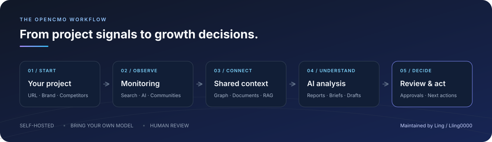
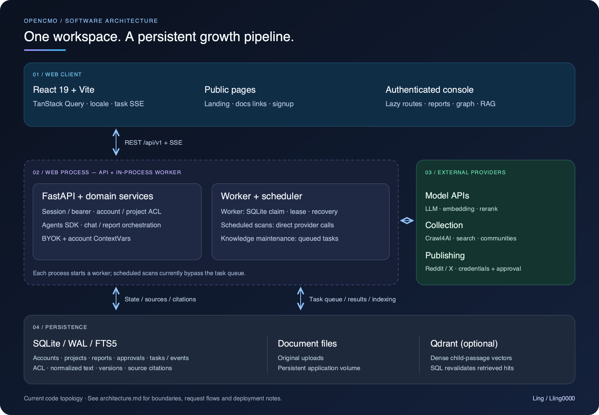

<div align="center">
  
  <h1>OpenCMO</h1>
  <p><strong>开源 AI 增长工作台。</strong></p>
  <p>看清产品在哪里被发现、用户正在讨论什么，<br />并找到下一步值得执行的增长行动。</p>
  <p>
    <a href="README.md">English</a> · <a href="README_zh.md">中文</a> · <a href="README_ja.md">日本語</a> · <a href="README_ko.md">한국어</a> · <a href="README_es.md">Español</a>
  </p>
  <p>
    <a href="https://github.com/Lling0000/OpenCMO/actions/workflows/ci.yml"></a>
    
    
    
  </p>
  <p><a href="#opencmo-能做什么">项目介绍</a> · <a href="#快速开始">快速开始</a> · <a href="docs/rag.md">知识库与 RAG</a> · <a href="docs/configuration.md">配置指南</a></p>
</div>

<p align="center">
  
</p>

## OpenCMO 能做什么

OpenCMO 是面向独立开发者、开源项目维护者和小型产品团队的自托管 AI CMO（首席营销官）。它把搜索表现、社区讨论、竞品研究和项目文档放进同一个工作区，帮助你理解产品的增长机会。

从一个产品 URL 开始，OpenCMO 会建立项目上下文、收集外部信号，再由不同领域的 AI Agent 生成报告、内容草稿和按优先级排序的建议。定时扫描帮助你持续观察变化，审批队列让你掌握发布决策。

| 核心能力 | 你可以做什么 |
| --- | --- |
| **SEO 与搜索排名** | 检查网站技术健康度、AI 爬虫可访问性，并持续追踪关键词排名。 |
| **AI 搜索可见度（GEO）** | 通过已支持的 AI 服务检查品牌提及与引用；覆盖范围取决于配置的集成。 |
| **社区与竞品** | 发现相关讨论、跟踪品牌提及，在知识图谱中探索竞品、关键词与讨论之间的关系。 |
| **知识库（RAG）** | 检索自己的文档和历史报告，让对话、报告与草稿带有来源引用。 |
| **报告与 AI 对话** | 生成战略报告和周报，获得面向人的解读与 Agent Brief，或围绕项目数据继续讨论。 |
| **内容与审批** | 准备内容与触达草稿、审核建议行动，并按需启用支持的发布集成。 |

**使用自己的模型。** 配置 OpenAI 或兼容接口的地址、支持工具调用的模型和 API Key。搜索、社区与发布集成可以根据实际需要逐步补充。

直接发布目前支持 Reddit 和 Twitter/X，需要配置平台凭据并设置 `OPENCMO_AUTO_PUBLISH=1`。其他触达内容以草稿形式供人工审核。

## 从一个 URL 到行动计划

1. **建立上下文**：爬取产品 URL，分析品牌、类别、关键词和竞品。
2. **收集信号**：通过可用的数据源获取 SEO、AI 搜索、关键词排名与社区信息。
3. **综合分析**：清洗结果，由领域 Agent 分别审查，再汇总优先级。
4. **产出结果**：保存发现、生成报告与 Brief，并准备待审核的行动。
5. **持续监控**：设置每日、每周或每月扫描，与历史结果对比。

监控流水线包含六个阶段：构建上下文 → 收集信号 → 标准化 → 领域审查 → 策略综合 → 持久化。报告、对话和草稿复用同一份项目上下文，减少重复介绍产品的工作。

## 快速开始

### Docker Compose

Docker 会同时构建前端和后端。安装 Docker 与 Compose 后执行：

```bash
git clone https://github.com/Lling0000/OpenCMO.git
cd OpenCMO
cp .env.example .env
```

编辑 `.env`，将 `OPENAI_API_KEY` 设置为你的模型密钥。使用兼容接口时，还需设置 `OPENAI_BASE_URL` 和 `OPENCMO_MODEL_DEFAULT`；具体示例见[配置指南](docs/configuration.md)。

```bash
docker compose up -d --build
```

打开 **[http://localhost:8080](http://localhost:8080)**，从 URL 创建项目并启动首次扫描。也可以在网页设置中配置模型。

<details>
<summary><strong>从源码运行</strong> — Python 3.10+ 与 Node.js 20+</summary>

```bash
git clone https://github.com/Lling0000/OpenCMO.git
cd OpenCMO
python3 -m venv .venv
source .venv/bin/activate
pip install -e ".[all]"
crawl4ai-setup
cp .env.example .env
```

在 `.env` 中配置模型密钥，然后构建前端并启动服务：

```bash
cd frontend
npm ci
npm run build
cd ..
opencmo-web
```

打开 `http://localhost:8080`。运行网页界面必须先完成前端构建。

</details>

### 跑通第一个项目

- 添加产品或仓库 URL，检查自动识别的项目上下文。
- 启动扫描，查看搜索、社区与竞品发现。
- 在 AI 对话中追问某个发现，或生成战略报告。
- 添加来源文档，让回答结合自己的知识。
- 审核草稿和建议，安排下一次扫描。

## 让回答有自己的知识来源

可选知识库支持文本型 PDF、DOCX、Markdown、TXT、粘贴文本、公开网页和历史报告。检索结合 **Qdrant 向量检索、BM25、标题与实体召回、排序融合及重排**，将相关上下文和来源引用带入生成结果。

```bash
# 启动应用和可选的向量数据库。
docker compose --profile rag up -d --build
```

进入 **知识库 → 模型与检索**，配置 Embedding 与 Rerank 服务，测试连接并启用检索。上传文档后，等待索引完成再提问。

文档默认仅对所在项目可见。账号内共享与允许来源用于对外内容，是两个独立设置。配置、权限、API 与模型评估方法见 [RAG 指南](docs/rag.md)。

## 架构与开发



| 层级 | 技术栈 |
| --- | --- |
| 网页界面 | React 19 · TypeScript · Vite · TanStack Query |
| API 与 Agent 编排 | FastAPI · OpenAI Agents SDK |
| 后台任务 | 扫描、报告、图谱扩展与知识索引 Worker |
| 存储与检索 | SQLite / FTS5 · 可选 Qdrant |
| 数据采集 | Crawl4AI · 搜索及各平台数据源 |

```text
frontend/src/              网页界面、项目视图与设置
src/opencmo/agents/         CMO 与领域 Agent
src/opencmo/tools/          爬取、搜索、审计与平台集成
src/opencmo/services/       项目分析与审批流程
src/opencmo/background/     任务执行与进度
src/opencmo/rag/            文档入库、混合检索与来源引用
src/opencmo/storage/        SQLite 持久化
src/opencmo/web/            API 路由与认证
```

<details>
<summary><strong>开发命令</strong></summary>

完成源码依赖安装后：

```bash
pip install pytest pytest-asyncio ruff
pytest tests/
ruff check src/ tests/

cd frontend
npm ci
npm run dev
```

Vite 开发服务运行在 `http://localhost:5173`，API 请求代理到后端的 `8080` 端口。

</details>

## 文档导航

- [架构说明](docs/architecture.md)：组件图、请求链路与数据边界。
- [优化审查](docs/optimization-review.md)：已实施改进、测量结果与后续优先级。
- [配置指南](docs/configuration.md)：模型服务与可选集成。
- [部署说明](docs/deployment.md)：服务托管、持久化与备份。
- [知识库与 RAG](docs/rag.md)：文档入库、检索与引用。
- [RAG 验证记录](docs/rag-validation.md)：测试范围、容量测量与评估状态。
- [参与贡献](CONTRIBUTING.md)：开发流程与贡献署名。

当前由 **[Ling（`Lling0000`）](https://github.com/Lling0000)** 维护。历史贡献记录见 [CONTRIBUTORS.md](CONTRIBUTORS.md)。

## 社区交流

[LINUX DO](https://linux.do/) — 真正的技术社区
