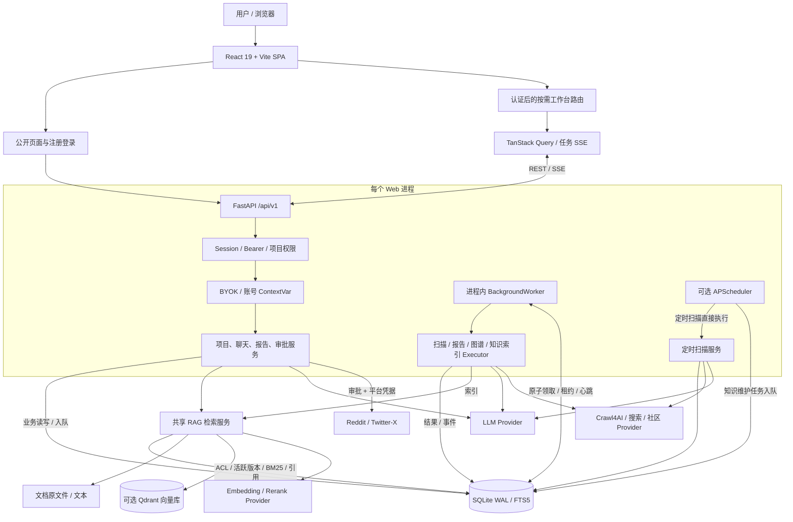
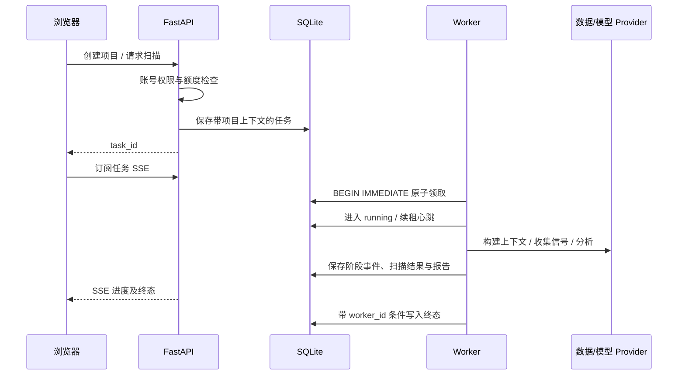
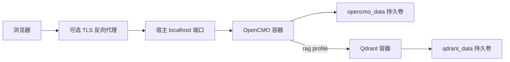

# OpenCMO 架构说明

> 维护者：Ling（`Lling0000`） · 2026-10-13 · 以本仓库代码为依据。图中展示当前软件结构，不代表已核验生产服务器的运行版本。

[打开完整 SVG 架构图](assets/architecture.svg) · [优化审查与实施记录](optimization-review.md) · [返回项目介绍](../README_zh.md)

## 1. 系统定位与边界

OpenCMO 是自托管 AI 增长工作台。它围绕账号和项目组织网站审计、搜索排名、AI 可见性、社区讨论、竞品关系、知识来源、报告与待审核行动。

目前采用模块化单体：React SPA 与 FastAPI 分离，FastAPI 生命周期启动进程内 Worker 和可选 APScheduler；业务数据和持久任务队列位于 SQLite；RAG 的向量存储是可选 Qdrant。当前没有 Redis/Celery 或独立消息总线。将 Worker 单独部署属于后续演进方案。

## 2. 可编辑逻辑图

SVG 是可直接修改的矢量源文件。下面的 Mermaid 展示同一套组件关系，便于评审时编辑。

## 3. 各层职责与代码入口

| 层级 | 职责 | 代码入口 |
| --- | --- | --- |
| 前端入口 | 公网页直接加载；工作台通过认证后按需加载；路由失败提供恢复入口 | [App.tsx](../frontend/src/App.tsx)、[vite.config.ts](../frontend/vite.config.ts) |
| 前端请求 | JSON API、BYOK header、401 通知、Query 缓存及任务 SSE | [api/client.ts](../frontend/src/api/client.ts)、[useTaskEvents.ts](../frontend/src/hooks/useTaskEvents.ts) |
| API 与权限 | 路由注册、Session/Bearer、CSRF、项目账号权限、请求上下文 | [web/app.py](../src/opencmo/web/app.py)、[web/auth.py](../src/opencmo/web/auth.py) |
| 领域服务 | 项目分析、扫描编排、报告、审批与发布 | [services/](../src/opencmo/services/)、[monitoring.py](../src/opencmo/monitoring.py)、[report_pipeline.py](../src/opencmo/report_pipeline.py) |
| 模型访问 | 请求/账号配置解析、兼容模型调用、重试与 failover | [llm.py](../src/opencmo/llm.py) |
| 任务系统 | 入队、去重、原子领取、租约、心跳、取消、失败与恢复 | [background/service.py](../src/opencmo/background/service.py)、[background/storage.py](../src/opencmo/background/storage.py)、[background/worker.py](../src/opencmo/background/worker.py) |
| 关系存储 | Schema、迁移、账号、项目、任务、报告、引用 | [storage/_db.py](../src/opencmo/storage/_db.py)、[rag/schema.py](../src/opencmo/rag/schema.py) |
| RAG | 解析、父子分块、索引、混合检索、预算与引用 | [rag/](../src/opencmo/rag/) |

## 4. 一次扫描如何执行

监控包括上下文构建、信号收集、标准化、领域审查、策略综合和持久化。报告生成有自己的多阶段流程，二者不是同一条流水线。Worker 默认全局并发为 4，各任务类型默认限额为 1，可通过环境变量调整；这是单进程限制，增加 Web 进程会增加总并发。

队列与事件持久化后可恢复，但这不等于外部副作用 exactly-once。租约失效后的取消是协作式的，已经发出的发布请求不会被撤回。

### 定时扫描的旁路

[APScheduler 注册](../src/opencmo/scheduler.py)当前直接调用 `run_scheduled_scan()`，执行扫描并写入数据库；这条路径没有经过 BackgroundWorker 的领取、租约或并发门控。知识维护任务由 Scheduler 触发后进入知识任务队列。

因此，Worker 的默认并发限制不能解释所有定时扫描的成本。后续应统一任务入口，并一并处理定时任务的账号凭据、额度和跨实例重复触发。

## 5. RAG 数据流

1. 文档进入项目私有或账号共享范围，保存原文件、解析文本、版本和元数据。
2. 解析与父子分块生成检索单元；SQLite/FTS5 保存全文索引，Qdrant 保存子块向量。
3. 查询经过可选改写后，执行 dense、BM25、标题/实体三路召回；RRF 融合后按配置重排。
4. 外部调用结束后，SQL 重新核验账号、项目、删除状态和活跃版本，避免使用过期向量或已撤销来源。
5. 精确计算最终拼接上下文 token 数，在预算内保留完整片段；保存引用及原文位置。
6. 对话、报告和内容草稿共享检索服务，但内部用途与对外用途有不同筛选条件。

权限以 SQL 为准，Qdrant 不是账号权限的唯一来源。Embedding/Rerank 与聊天模型分别配置；具体设置及当前实测范围见 [RAG 文档](rag.md)和[验证记录](rag-validation.md)。聊天用途当前包含关键词推断，仍需进一步设计显式用途契约，不能将推断视为完整的数据防泄露保证。

## 6. 自部署拓扑

仓库的参考 Docker 部署将宿主 `127.0.0.1:8080` 映射至容器服务，并用 `opencmo_data` 保存 SQLite 和文档。`rag` profile 增加 Qdrant 和其持久卷；应用内配置指向 Compose 服务名。Dockerfile 在独立阶段构建前端，然后构建 Python 运行层。

这张图描述仓库配置，不是线上部署证明。自定义反向代理端口应与实际宿主映射一致。备份应覆盖 SQLite、原文目录和配置；向量可以重建，但原文件、账号配置与引用不能只靠 Qdrant 备份恢复。

## 7. 演进方向

当前最有价值的演进顺序是：先降低前端加载成本和任务故障率，再补账号缓存隔离、模型错误分类、外部副作用幂等和 Worker 可观测性；最后根据真实队列延迟和数据库争用数据决定是否拆独立 Worker/迁移数据库。

后续优化的触发条件、验收方式和本次已实现范围见 [optimization-review.md](optimization-review.md)。
